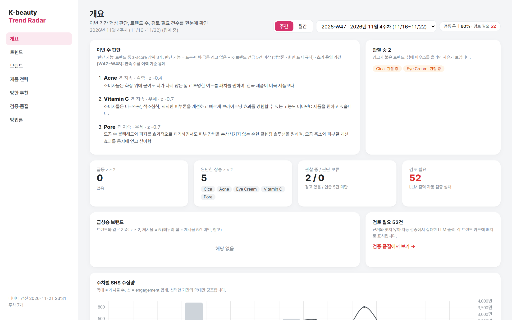
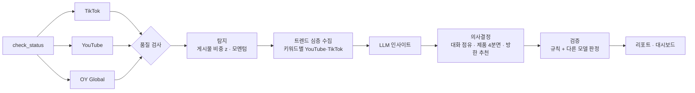

# K-beauty Trend Radar

미국 TikTok·YouTube와 Olive Young Global·Sephora 데이터를 매주 모아, K-뷰티에서 지금 뜨는 니즈와 그 대화를 어떤 브랜드가 차지하고 있는지 정리하는 파이프라인입니다. LLM이 쓴 해석은 규칙과 다른 모델로 다시 검증하고, 결과는 주·월 단위로 고를 수 있는 대시보드로 나옵니다.



- 대시보드: **https://eugenee726.github.io/K-beauty-agent-intelligence-Agent-/** — 정적 웹앱입니다(소스 [`dashboard/`](dashboard/), 공개본 [`docs/`](docs/)). `?w=2026-W47#trends`, `?m=2026-11#brands`처럼 URL로 기간과 화면을 고릅니다.
- 운영: AWS Lightsail의 Apache Airflow가 매주 목요일 09:00(KST)에 전체를 실행하고, YouTube는 매일 수집합니다.
- 범위: 추적 K-뷰티 브랜드 43개(제품 1,534개), 랭킹에 오른 브랜드까지 포함한 제품 카탈로그 1,736개. 특정 회사 관점 없이 같은 기준으로 비교합니다.

## 왜 만들었나

해외 K-뷰티 수요는 SNS에서 생겨 리테일 구매와 방한 쇼핑으로 이어집니다. 그런데 트렌드, 리뷰, 인기 제품이 플랫폼마다 흩어져 있어서 무엇이 떴는지는 보여도 소비자가 왜 원하는지, 누가 그 자리를 잡고 있는지는 잘 보이지 않습니다. 이 프로젝트는 그 세 가지를 매주 같은 기준으로 계산해서 보여 줍니다. 아모레퍼시픽 공모전 과제에서 시작했고, 지금은 브랜드 중립 관점으로 바꿔 운영하고 있습니다.

## 구조



| 단계 | 하는 일 | 코드 |
|---|---|---|
| 수집(탐지용) | YouTube 검색(Data API, 매일), TikTok 해시태그(Apify, 매주), OY 랭킹·리뷰(Playwright), Sephora 리뷰(Bazaarvoice) | `tools/collect/` |
| 품질 검사 | 플랫폼별 최소 건수, 빈 본문 비율. 기준 미달이면 LLM 단계를 돌리지 않음(TikTok은 경고만) | `tools/quality/data_quality.py` |
| 탐지 | 키워드별 게시물 비중의 z-score(순간 급등)와 engagement 비중 모멘텀(지속 상승) | `tools/analyze/stats_tool.py`, `momentum_tool.py` |
| 트렌드 심층 수집 | 선정된 키워드로 YouTube·TikTok을 한 번 더 검색해 해석용 캡션을 보강. 탐지에는 쓰지 않음 | `tools/collect/deep_collect.py` |
| 인사이트 | Claude Sonnet이 캡션 샘플을 읽고 소비자 니즈와 관련 제품을 뽑음 | `tools/analyze/llm_insight_tool.py` |
| 의사결정 | 대화 점유(캡션 전체의 브랜드 언급을 코드로 집계해 우세·각축·공백), 제품 전략 4분면, 방한 추천 점수 | `agents/decision_agent.py`, `tools/analyze/brand_count.py` |
| 검증 | 규칙 검사(인용·언급 수·한국어)와 Claude Opus 판정(지지 / 근거 부족 / 모순) | `tools/quality/insight_checks.py`, `agents/validation_agent.py` |
| 출력 | 주간 HTML 리포트, 전체 주차 대시보드 | `tools/report/`, `dashboard/` |

## 판정 기준

판정은 모두 공개된 수식으로 합니다. 대시보드 방법론 페이지에도 같은 내용과 화면 표시 기준값이 있습니다.

- **트렌드 후보**: 게시물 비중 z ≥ 2.0(순간 급등) 또는 3개 데이터 주차 연속 상승 + 모멘텀 ≥ 1.5(지속 상승). 광의어와 브랜드명은 빼고, 게시물 5건 이상, 최대 10개.
- **대화 점유**: 트렌드 키워드가 들어간 캡션 전체에서 등록 브랜드 이름을 코드로 셉니다(캡션당 1회). 1위가 30% 이상이면서 2위의 2배 이상이고 3건 이상이면 우세, 그런 브랜드가 없으면 각축, 언급이 없으면 공백. LLM이 센 브랜드 수는 판정에 쓰지 않습니다.
- **제품 4분면**: VOC 긍정률 0.65와 별점 추세로 PUSH NOW / FIX & PUSH / HOLD / MONITOR.
- **방한 추천**: 0.35 × SNS 트렌드 강도 + 0.35 × VOC 긍정률 + 0.30 × 리테일 순위 점수.

## 결과 (2026-W47)

| 트렌드 | 모양 | 대화 점유 | 1위 브랜드 (점유 · 2위 대비) | 신뢰 |
|---|---|---|---|---|
| Cica | 지속 상승 | 각축 | SKIN1004 (15% · 1.0배) | 관찰 중 (게시물 7건) |
| Acne | 지속 상승 | 각축 | ANUA (14% · 1.1배) | 판단 가능 |
| Eye Cream | 지속 상승 | 각축 | BIODANCE (16% · 1.5배) | 관찰 중 (영상 1개가 조회수 99%) |
| Vitamin C | 지속 상승 | 우세 | ARENCIA (33% · 3.0배) | 판단 가능 |
| Pore | 지속 상승 | 우세 | MEDICUBE (32% · 3.1배) | 판단 가능 |

검증: 규칙 검사 통과 67%(96/143), 다른 모델(Opus) 판정 통과 53%(66/125). 서로 다른 오류 34건을 잡았고, 대부분 LLM이 캡션에 없는 브랜드를 센 경우라 브랜드 집계를 코드로 옮겼습니다.

## 실행

필요한 것: Python 3.11, Docker, API 키(Anthropic, YouTube Data API, Apify, OpenAI).

```bash
# 1. 환경 변수
cp .env.example .env          # 키를 채운다

# 2. 로컬에서 한 번 돌리기
pip install -r requirements.txt
playwright install chromium
python init_db.py
python main.py build-catalog  # 제품 카탈로그 (처음 한 번, 오래 걸림)
python main.py full           # 수집 → 분석 → 결정 → 리포트

# 3. 대시보드 만들기
python -m tools.report.dashboard_builder db/kbeauty.db exports/dashboard
# exports/dashboard/index.html 을 브라우저로 연다
```

정기 실행은 Airflow로 합니다.

```bash
cd airflow
echo "AIRFLOW_UID=$(id -u)" > .env
docker compose up airflow-init && docker compose up -d
ssh -L 8080:localhost:8080 <서버>   # 브라우저에서 localhost:8080
```

DAG는 세 개입니다.

- `kbeauty_weekly`: 매주 목요일. 수집부터 대시보드까지 전체 실행
- `kbeauty_youtube_daily`: 매일 17:30. YouTube 하루치 수집
- `kbeauty_catalog`: 매월 1일. 제품 카탈로그 갱신

이미 처리된 단계는 건너뛰고, 과거 주차는 수집 없이 분석만 다시 돌릴 수 있습니다.


## 폴더

```
airflow/      Dockerfile, docker-compose, DAG (weekly, youtube_daily, catalog)
agents/       analysis · decision · validation · orchestrator
tools/
  collect/    tiktok · youtube · oy_global · sephora · deep_collect · brand_registry
  analyze/    stats · momentum · llm_insight · voc
  quality/    data_quality · insight_checks
  report/     html_report · dashboard_builder
dashboard/    대시보드 정적 파일 (index.html, app.js, style.css)
docs/         GitHub Pages 공개본 (대시보드 + data.js)
db/schema.sql 테이블 정의
```
