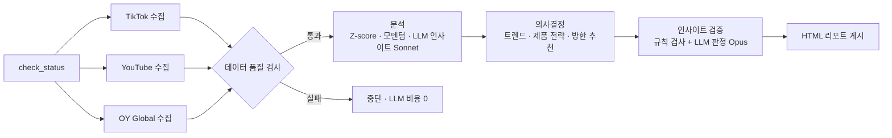

# K-Beauty Intelligence Agent

> **글로벌 고객이 K-Beauty 브랜드에 기대하는 포인트를, 실제 해외 반응 데이터에서 AI가 자동으로 찾아내 주 단위로 알려주는 에이전트**

해외 고객은 **올리브영 글로벌**과 **SNS**에서 K-Beauty 트렌드·리뷰·인기 제품을 확인하고, **쇼핑리스트를 미리 작성해 한국을 방문**합니다.
이 프로젝트는 그 "해외 고객의 실제 반응"을 매주 자동 수집·분석해, K-뷰티 브랜드가 **신속·정확하게 대응**할 수 있도록 3가지 실행형 인사이트를 제공합니다.
LLM이 쓴 해석은 **다른 모델이 원문 근거와 대조해 검증**한 뒤 리포트에 실립니다.

> 아모레퍼시픽 공모전 주제에서 출발해, 현재는 **K-뷰티 브랜드 43개를 같은 기준으로 비교하는 중립 관점**으로 확장했습니다.

| | |
|---|---|
| **무엇을** | 해외(미국) K-Beauty 트렌드·VOC·인기 제품을 AI가 분석 → 브랜드 대응 인사이트 자동 생성 |
| **어떻게** | Airflow 파이프라인 (수집 → 품질 검사 → 통계·LLM 분석 → 의사결정 → **LLM 출력 검증** → HTML 리포트) |
| **얼마나 자주** | 매주 목요일 자동 실행 (AWS Lightsail + Apache Airflow) |
| **규모** | 추적 브랜드 43개 · 제품 카탈로그 1,736개 |
| **결과물** | 3-탭 인터랙티브 HTML 리포트 (트렌드 / 제품 전략 / **방한 추천**) |

---

## 0. 목차

1. [핵심 결과물 — 3가지 인사이트](#1-핵심-결과물--3가지-인사이트)
2. [배경 및 문제 정의](#2-배경-및-문제-정의)
3. [데이터 소개 및 전처리](#3-데이터-소개-및-전처리)
4. [모델링 및 분석](#4-모델링-및-분석)
5. [왜 이렇게 설계했는가 — 투명한 설계의 두 가지 이유](#5-왜-이렇게-설계했는가--투명한-설계의-두-가지-이유)
6. [성과 및 결과](#6-성과-및-결과)
7. [자동화 — 지속적 인사이트 제공](#7-자동화--지속적-인사이트-제공)
8. [한계 및 향후 계획](#8-한계-및-향후-계획)
9. [기술 스택 · 실행 방법](#9-기술-스택--실행-방법)

---

## 1. 핵심 결과물 — 3가지 인사이트

매주 생성되는 HTML 리포트는 브랜드 의사결정에 바로 쓰이도록 **첫 화면(KPI · 이번 주 요약 · 검증 통과율) + 3개의 탭**으로 구성됩니다.

### 📈 ① 트렌드 인사이트 — "지금 뜨는 키워드에 어떻게 대응할까"
SNS에서 통계적으로 급등 중인 키워드를 **2개의 독립 축**으로 해석합니다.
- **기회 유형**(이 니즈의 대화를 누가 차지하고 있나 — 캡션 속 K-뷰티 브랜드 언급 점유 기준):
  | 유형 | 기준 | 마케터 행동 |
  |---|---|---|
  | `leader` 선점 | 1위 브랜드 언급 점유 ≥ 50% 그리고 ≥ 3건 | 주인공 브랜드는 강화, 그 외는 벤치마크 후 제형·가격·피부 타입으로 차별화 |
  | `contested` 각축 | K-브랜드 언급은 있으나 과반 브랜드 없음 | 먼저 "이 니즈 = 우리 브랜드"를 각인시키는 쪽이 유리 (콘텐츠·시딩) |
  | `white_space` 공백 | K-브랜드 언급 없음 | 맞는 제품이 있으면 **소통 공백**(메시지만 바꾸면 됨), 없으면 **제품 공백**(신제품·소싱 신호) |

  판매처(Olive Young, YesStyle)·사람 이름·서구 브랜드는 점유 계산에서 제외(`dim_brand` 등록 브랜드만). LLM이 연결한 제품은 점유가 아니라 "이 니즈에 맞는 제품"으로 표시.
- **트렌드 모양**(어떤 모양): `emerging`(신규 등장) / `sustained`(지속 상승) / `spike`(순간 급등) / `steady`(정체)
- 각 키워드의 3~5주 engagement 추이, SNS 실제 캡션 인용, 연결된 제품·언급 브랜드를 함께 제시

### 🛍️ ② 제품 전략 — "이 제품을 지금 어떻게 다룰까"
제품별 **VOC(리뷰) 긍정도 + 별점 추세** 중심으로 전략을 분류합니다.
- `PUSH_NOW`(긍정 + 별점 상승) / `FIX_AND_PUSH`(불만 신호: 별점 하락·부정 ≥ 0.35) / `HOLD`(긍정이나 정체) / `MONITOR`(관망)
- 별점 추세, 긍정/부정/니즈 키워드, 리뷰 유입량(표시용), 리테일 링크 제공

### ✈️ ③ 방한 추천(InboundPick) — **주제의 핵심**
**"쇼핑리스트를 미리 작성해 한국을 방문"하는 해외 고객**을 위한 추천 제품 Top 15.
- **"지금 해외에서 화제(SNS 트렌드 강도) + 실제로 만족도 높음(VOC) + 리테일 인기"** 를 결합한 Pick Score로 선정
  → `0.35 × SNS + 0.35 × VOC + 0.30 × 리테일 인기`
- **후보 풀** = OliveYoung(한국 ∪ 글로벌 랭킹) ∪ **Sephora(리뷰 활성 제품)** — 미국 현지 인기까지 포함
- 단순 판매 순위가 아니라 **"외국인이 한국 와서 살 가치가 있는가"** 관점으로 설계

---

## 2. 배경 및 문제 정의

### 2-1. 시장 배경 — 왜 지금, 왜 미국인가

K-Beauty는 미국에서 폭발적으로 성장하고 있으며, **아모레퍼시픽(AP)의 글로벌 무게중심도 미국으로 이동**하고 있다.

| 근거 | 내용 |
|------|------|
| **미국 K-뷰티 시장 급성장** | 2025년 미국 K-뷰티 매출 약 **$20억(+37% YoY)**, 한국은 프랑스를 제치고 **對美 화장품 수출 1위** |
| **AP 미국 매출, 중국 첫 추월** | 2025년 AP 미주 매출 **+20%**, 글로벌 리밸런싱으로 **미국 매출이 처음으로 중국을 추월** |
| **코스알엑스 인수 효과** | 2023년 완전 자회사화 이후 AP 미국 매출이 **2,867억(2023) → 5,246억(2024)** 으로 급증 |
| **SNS 발(發) 수요** | TikTok 발 K-뷰티 붐이 Sephora·Ulta·Amazon 실매출로 전환, 올리브영 LA 매장 2026년 오픈 예정 |

> 즉 미국은 AP에게 **"최대 성장 시장이자 전략 1순위"** 가 되었고, 그 수요는 **SNS에서 형성되어 리테일·방한 쇼핑으로 이어진다.** 이 흐름을 빠르게 포착하는 것이 곧 사업 기회다.

### 2-2. 문제

- 해외 K-Beauty 수요는 **올리브영 글로벌·SNS를 통해 형성**되고, **쇼핑리스트 작성 → 방한 쇼핑**으로 이어진다.
- 그러나 이 흐름은 **빠르고 분산적**이라, 브랜드가 수작업으로 추적하기 어렵다.
- AP는 "글로벌 고객의 니즈·성분·제형 변화, 신규 기회"를 **신속·정확하게** 포착해야 한다.

### 2-3. 우리가 푸는 문제 — "포인트"만으로는 부족하다

> 주제는 "글로벌 고객이 K-Beauty 브랜드에 기대하는 포인트"를 알려달라는 것이다.
> 그러나 **포인트만 제시해서는 실제 기획·전략·개발로 이어지지 않는다.**

- 브랜드 내부에서 그 포인트를 근거로 **기획·전략·개발을 추진**하려면, "왜 이 포인트인가"에 대한 **구체적이고 타당한 근거와 신뢰성**이 함께 와야 한다.
- 따라서 우리 에이전트는 **결과만 던지는 블랙박스가 아니다.** 모든 신호의 정의·가중치·임계값을 **직접 설계해 공개**하고, **객관적 사실(실제 SNS 반응·리뷰·랭킹)에만 근거**해 인사이트를 도출한다.
- 즉 이 에이전트의 목표는 **"기대 포인트 + 그 근거"를 함께 제공해, AP의 후속 기획·전략·개발을 독려**하는 것이다.

### 2-4. 목표

> 해외 고객의 **실제 반응 데이터**에서 트렌드·니즈·기회를 **자동 탐지**하고,
> **그 판단의 근거(수식·기준)까지 함께** 제시해, 브랜드가 바로 실행할 수 있는 인사이트를 **매주 지속적으로** 제공한다.

### 2-5. 도전 과제

- **정답(ground-truth) 라벨이 없다.** "이 트렌드가 진짜 기회였는가"를 사전에 알 수 없다.
  → 따라서 *예측 정확도*를 최적화하는 문제가 아니라, **합리적 신호를 정의하고 투명하게 결합하는** 문제로 접근했다. ([5장](#5-왜-이렇게-설계했는가--투명한-설계의-두-가지-이유) 참조)

---

## 3. 데이터 소개 및 전처리

### 3-1. 데이터 소스 — 왜 이 플랫폼들인가

| 구분 | 플랫폼 | 선정 이유 |
|------|--------|-----------|
| **리테일** | **OliveYoung Global** | ① 방한 외국인이 K-뷰티 쇼핑을 위해 **실제로 가장 많이 찾는 채널**(아래 근거) → 방한 동선과 직결. ② **글로벌 주문 랭킹 + 한국 현지 인기 랭킹을 동시 제공**해, "해외 수요 ↔ 한국 현지 인기"를 한 채널에서 비교 가능 |
| **리테일** | **Sephora USA** | 미국 주류 뷰티 리테일. K-Beauty의 **현지 시장 침투도**와 리뷰(BazaarVoice) 확보 |
| **SNS** | **TikTok** | K-Beauty 트렌드의 **최초 발화 채널**. 짧은 사이클로 신규 성분·제형 트렌드가 먼저 등장 |
| **SNS** | **YouTube** | 리뷰·하울·루틴 등 **심층 콘텐츠**. TikTok 대비 신뢰도 높은 소비자 반응 |

> **TikTok(선행) → YouTube(확산)** 의 교차 검증으로 "반짝 유행"과 "실제 트렌드"를 구분한다.

> **올리브영을 핵심 리테일로 선정한 근거 (방한 동선의 실증 데이터)**
> - 2025년 1~5월 방한 외국인 **720만 6,700명 중 596만 2,700명(80%↑)** 이 올리브영에서 구매 → **"외국인 10명 중 8명이 올리브영을 찾는다"**
> - 글로벌텍스프리(GTF) 기준 국내 화장품 결제의 **88%가 올리브영 매장**에서 발생
> - 2025년 방한 외국인 올리브영 누적 구매액 **1조 원 돌파**
>
> → 주제가 말한 **"쇼핑리스트 작성 → 방한 쇼핑"** 흐름의 종착점이 사실상 올리브영이므로, **OliveYoung Global을 방한픽의 핵심 데이터 소스**로 선정했다. 또한 OY Global은 한 채널에서 **글로벌·한국 양쪽 랭킹**을 노출하므로, "해외에서 뜨는 제품 + 한국에서도 인기 있는 제품"을 결합한 방한 추천 설계가 가능하다.

### 3-2. 미국 타겟을 데이터로 어떻게 구현했는가

미국을 타겟으로 삼은 전략적 이유는 [2-1 시장 배경](#2-1-시장-배경--왜-지금-왜-미국인가)에서 다뤘다. 여기서는 그 타겟을 **수집 단계에서 어떻게 정규화했는지**를 설명한다.

| 플랫폼 | 미국 정규화 방식 |
|--------|------------------|
| YouTube | `regionCode="US"` + `relevanceLanguage="en"` (API 레벨에서 미국·영어 한정) |
| TikTok | `proxyCountryCode="US"`(미국 IP로 미국 피드 접속) + `textLanguage=="en"`(비영어 캡션 제거) **2단계 필터** |

> TikTok은 해시태그 검색이 글로벌 풀에서 나오므로, **미국 프록시(1차) → 영어 캡션만(2차)** 2단계로 미국 소비자 반응에 근접시킨다.

### 3-3. SNS 수집·처리 과정

```
[1] 수집 (해시태그/키워드 기반)
    TikTok  : K-Beauty 해시태그 21종 × 주당 40건 (Apify)
    YouTube : K-Beauty 검색어 × 영상 통계 (YouTube Data API)
        ↓
[2] 노이즈 필터링 (2단계)
    · 해시태그뿐 아니라 캡션 텍스트를 직접 분석
    · K-Beauty 성분/제형/제품 키워드 사전(KBEAUTY_TERMS)에 없으면 제거
      → "생일파티", "100k뷰" 같은 비관련 포스트 원천 차단
        ↓
[3] 키워드 정규화·집계
    · 캡션 → 성분/제형/브랜드 키워드 추출 (예: "snail mucin", "glass skin")
    · engagement = 가중합 (아래 산식)
    · 주차 × 키워드 단위로 집계 → fact_sns_signals
```

**Engagement 산식** (플랫폼 특성 반영)

| 플랫폼 | 산식 (조회수 / 좋아요 / 댓글) |
|--------|------------------------------|
| TikTok | `조회수×0.3 + 좋아요×1.0 + 댓글×2.0` |
| YouTube | `조회수×0.2 + 좋아요×1.5 + 댓글×3.0` |

**왜 플랫폼마다 가중치가 다른가** — 같은 "조회수 1회"라도 플랫폼마다 의미가 다르기 때문이다. 단순 도달(reach)이 아니라 **소비자의 능동적 관심**을 측정하려면, 각 지표가 그 플랫폼에서 갖는 무게를 반영해야 한다.

| 관점 | TikTok | YouTube |
|------|--------|---------|
| **조회수의 성격** | 알고리즘이 피드에 강하게 밀어 넣어 **수동적으로 부풀려짐** → 가중치 낮춤(0.3) | 검색·구독 기반이라 상대적으로 의도적이나, 자동재생 등으로 여전히 가벼운 신호 → 더 낮춤(0.2) |
| **좋아요·댓글의 의미** | 빠른 스크롤 환경이라 댓글은 **드물고 의도적** → 댓글 가중치(2.0) | 긴 영상을 보고 남기는 좋아요·댓글은 **명확한 호응** → 좋아요(1.5)·댓글(3.0) 모두 상향 |
| **핵심 원리** | 조회수 ↓, 능동 반응 ↑ | 능동 반응을 TikTok보다 더 높게 |

> 결론: 두 플랫폼 모두 **"수동적 도달(조회수)보다 능동적 반응(좋아요·댓글)에 더 큰 가중치"** 를 두되, 플랫폼별로 각 지표의 신뢰도가 다르므로 가중치를 차등 적용해 **알고리즘 노출에 휘둘리지 않는 '진짜 관심'** 을 측정한다.

### 3-4. 제품 카탈로그 빌드 (카테고리 구축)

분석의 기준이 되는 **제품 마스터(`dim_product`, 1,736개)** 를 월 1회 자동 구축합니다.

```
[1] 추적 브랜드 정의 (dim_brand 브랜드 레지스트리, 43개)
    아모레퍼시픽 13개 (Sulwhasoo, LANEIGE, COSRX …)
    + APR(medicube) · Anua · TIRTIR · Beauty of Joseon · Torriden · numbuzin … 30개
    → 브랜드 추가는 레지스트리에 한 줄 추가로 끝 (코드 수정 없음)
        ↓
[2] 플랫폼별 제품 카탈로그 스크랩
    · OliveYoung Global : 브랜드별 제품 + URL + 식별자(prdtNo)
    · Sephora USA       : 제품 + 성분 + BazaarVoice product ID
        ↓
[3] 교차 플랫폼 제품 동일화 (핵심 난제 — 아래 참조)
    · 제품명 정규화 → 유사도 매칭 → 같은 제품이면 동일 product_id로 통합
        ↓
[4] 통합 product_id 부여 (S0000xxxx) + 카테고리·성분·효능 태깅
        ↓
[5] dim_product 저장 → 이후 SNS 키워드·리테일 랭킹·리뷰가 이 마스터에 연결됨
```

#### 왜 [3]단계가 핵심 난제인가 — "같은 제품, 다른 이름"

같은 제품이라도 **플랫폼마다 표기가 완전히 다르다.** 단순 문자열 비교로는 동일 제품을 묶을 수 없다.

| 플랫폼 | 동일한 코스알엑스 제품의 표기 (예시) |
|--------|--------------------------------------|
| OliveYoung Global | `Advanced Snail 96 Mucin Power Essence` |
| Sephora USA | `Snail Mucin 96% Power Repairing Essence 100mL` |

이름이 다른 이유: ① 마케팅 수식어("Power Repairing"), ② 용량 표기("100mL"), ③ 토큰 순서, ④ 특수문자·대소문자 차이. **이를 동일 제품으로 묶지 못하면, OY의 인기 신호와 Sephora의 리뷰가 서로 다른 제품으로 흩어져 분석이 깨진다.**

**해결 — 정규화 + 퍼지 매칭 ([_product_utils.py](tools/collect/_product_utils.py))**

```
1) 정규화 (normalize_for_matching) — 6단계
   · 마케팅 설명 제거: "with Ceramides...", "- Gently Exfoliate..."
   · 용량 제거: "100mL", "45g"
   · 카테고리·수식어 제거: "moisturizer", "repairing", "hydrating" …
   · 관사/전치사 제거: "the", "and", "an"
   · 소문자화 + 특수문자 → 공백
   · 시리즈 숫자 통일: "Atobarrier 365" → "atobarrier365"

2) 유사도 매칭 (rapidfuzz)
   · token_sort_ratio  : 토큰 순서가 달라도 비교 ("A B C" ≈ "C B A")
   · token_set_ratio   : 한쪽이 다른쪽의 부분집합이어도 보완
   · 두 점수 중 높은 값 사용, 동일 브랜드 내에서만 비교

3) 임계값 85점 이상이면 동일 제품 → 기존 product_id에 통합
   (오판 방지를 위해 임계값을 보수적으로 높게 설정)
```

> 결과: 위 예시의 두 표기가 정규화 후 `snail 96 mucin power essence` ≈ `snail mucin 96 power essence` 로 수렴 → **동일 product_id로 통합**되어, OY 인기·Sephora 리뷰·SNS 키워드가 **하나의 제품으로 연결**된다.

> 이 카탈로그가 있어야 **"SNS에서 뜬 키워드 ↔ 실제 제품"** 을 연결할 수 있고,
> "SNS에서 급등 중인데 리테일엔 아직 반영 안 된" 선점 기회를 탐지할 수 있다.

### 3-5. 수집 데이터 요약 (현재 누적)

| 테이블 | 내용 | 규모(예시) |
|--------|------|-----------|
| `dim_product` | 제품 카탈로그 (추적 브랜드 + 랭킹 등장 브랜드) | 1,736 |
| `fact_sns_raw` | SNS 원문 포스트 | ~3,000 |
| `fact_sns_signals` | 키워드×주차 집계 | ~1,100 |
| `fact_retail_rankings` | 리테일 랭킹 | ~310 |
| `fact_raw_reviews` | 제품 리뷰 원문 | ~5,600 |

---

## 4. 모델링 및 분석

파이프라인은 **4개 에이전트**로 구성되며, Apache Airflow DAG가 순서대로 실행합니다.

```
Airflow DAG (kbeauty_weekly — 매주 목 09:00 KST)
   ├── CollectionAgent : SNS·리테일·리뷰 수집 + 노이즈 필터
   ├── AnalysisAgent   : 통계 분석 + LLM 인사이트 (Claude Sonnet)
   ├── DecisionAgent   : 3가지 실행형 인사이트 생성 (3 Builder)
   └── ValidationAgent : LLM 출력 검증 (규칙 검사 + Claude Opus 판정)
```

### 4-1. 통계 분석 (AnalysisAgent)
- **Z-score** : 과거 주차(3주 이상) engagement 평균 대비 **순간 급등** 강도 (≥2.0 = 이상치)
- **Welch t-test** : 이번 주 vs 이전 4주 유의차 검증
- **모멘텀(최근 3주)** : 현재 주 ÷ 3주 전 engagement = **지속 상승** 배수 + 연속 상승 단계(`weeks_rising`)
- **트렌드 후보** = 순간 급등(z ≥ 2.0) ∪ 지속 상승(3주 연속 상승 + 모멘텀 ≥ 1.5), 광의어·브랜드명 제외, 게시물 ≥ 5, 최대 10개
  (브랜드 급상승은 리포트의 "이번 주 급상승 브랜드"에서 같은 기준으로 따로 표시)
- **크로스플랫폼** : TikTok ↔ YouTube 동시 관측 여부 (트렌드 진위 검증)

> **Z-score(순간 급등)와 모멘텀(지속 상승)은 서로 다른 시점을 측정** → 둘을 함께 보면 "반짝 화제 vs 진짜 트렌드"를 구분한다.

### 4-2. LLM 인사이트 (Claude)
급등 키워드를 Claude(`claude-sonnet-5-5`)가 분석해:
- 어떤 **제품**과 연결되는가 (직접/간접) + **SNS 캡션 근거 인용** (후보 카탈로그 최대 150개 중 선택)
- 어떤 **브랜드**가 함께 언급되는가 (특정 회사 관점 없이 중립)
- 소비자가 실제로 원하는 **니즈**는 무엇인가 (한국어 요약)

### 4-3. 3가지 의사결정 (DecisionAgent)
| Builder | 출력 | 핵심 신호 |
|---------|------|-----------|
| TrendInsightBuilder | 트렌드 인사이트 | 기회 유형 × 트렌드 모양 |
| ProductInsightBuilder | 제품 전략 | VOC 긍정도 + 별점 추세 + 불만 신호 |
| InboundPickBuilder | 방한 추천 | SNS 트렌드 강도 + VOC + 리테일 인기 (OY ∪ Sephora) |

---

## 5. 왜 이렇게 설계했는가 — 투명한 설계의 두 가지 이유

> 이 프로젝트의 가장 중요한 부분입니다. 우리는 **모든 신호의 정의·가중치·임계값을 직접 설계해 공개**하는 "화이트박스" 방식을 택했습니다. 그 이유는 두 가지입니다.

### 5-1. 두 가지 설계 동기

**① 정답(ground-truth) 라벨이 없다 → 정확도 대신 "논리적 타당성"으로 승부한다**
- "이 트렌드가 정말 기회였는가"에 대한 사전 정답 데이터가 존재하지 않는다.
- 따라서 *예측 정확도*를 최적화하는 문제가 아니라, **합리적인 대리 신호(proxy)를 정의하고 그 결합 규칙을 투명하게 만드는** 문제다.
- 정답이 없을수록 **"왜 이 점수인가"를 설명할 수 있어야** 결과를 신뢰할 수 있다.

**② 이 에이전트는 "포인트"가 아니라 "실행"을 만든다 → 근거가 없으면 기획·전략으로 이어지지 않는다**
- 우리 에이전트의 목표는 단순히 "기대 포인트"를 알려주는 데서 끝나지 않는다. 브랜드 내부의 **기획·전략·개발을 실제로 독려**하는 것이 목표다. ([2-3](#2-3-우리가-푸는-문제--포인트만으로는-부족하다) 참조)
- 그런데 *"이 키워드가 뜬다"* 는 결과만 던지면, 담당자는 그 근거를 다시 검증해야 하고 실행으로 옮기기 어렵다.
- 따라서 **"포인트 + 그 근거(수식·기준·실제 SNS·리뷰 데이터)"** 를 함께 제공해, 담당자가 **바로 의사결정·기획에 활용**할 수 있게 한다.

> **결론**: 두 동기 모두 한 방향을 가리킨다 — **블랙박스가 아니라, 객관적 사실에 근거한 투명한 기준을 직접 설계해 공개한다.** 모든 점수는 [리포트 하단에 수식으로 함께 표시](#6-성과-및-결과)되며, 누구나 "왜 이 제품이 PUSH_NOW인가"를 추적할 수 있다.

### 5-2. 원칙: "측정 가능한 대리 신호 + 투명한 결합"
위 두 동기에 따라, 비즈니스적으로 타당한 **대리 신호(proxy)** 를 정의하고 그 결합 규칙을 **설명 가능**하게 만들었습니다. 아래 5-3은 그 핵심 설계 결정 3가지와 각각의 근거입니다.

### 5-3. 핵심 설계 결정 3가지 (각각의 근거)

**① 트렌드를 "1축"이 아니라 "2축"으로 분리한 이유**
- 단일 점수로 트렌드를 줄세우면 "누구의 기회인지"와 "얼마나 지속될지"가 뒤섞인다.
- 그래서 **기회 유형(대화 점유 구도)** 과 **트렌드 모양(급등/지속)** 을 직교 축으로 분리.
- 효과: "한 브랜드가 선점(leader) × 지속 상승(sustained) → 벤치마크·차별화", "각축(contested) × 신규 등장(emerging) → 먼저 각인시키는 쪽이 유리" 처럼 **액션이 달라지는 해석**이 가능.
- 기회 유형은 처음에 AP 관점 4종(amplify/position/counter/new_entry)이었으나, 43개 브랜드 중립 관점으로 바꾸며 "AP 대 경쟁사"가 성립하지 않아 **대화 점유 구도** 3종으로 재정의했다. 첫 버전(브랜드 개수 기준)은 LLM이 연결한 제품 브랜드까지 세어 W47 7개가 모두 contested로 나와, 언급 점유 기준으로 다시 고쳤다.

**② 제품 전략을 "리테일 순위"가 아니라 "VOC 모멘텀" 중심으로 바꾼 이유**
- 리테일 순위는 **OliveYoung 단일 플랫폼 의존**이라 결측이 많고(전체 제품의 다수가 랭킹 없음), 후행 지표다.
- 반면 VOC(리뷰)는 제품만 있으면 수집 가능하고, **소비자 반응의 선행 신호**다.
- 그래서 리테일 비중을 낮추고(보조), **긍정도 + 별점 추세 + 불만 신호**를 주 신호로 전환.
- 리뷰 유입량(플랫폼 전체 리뷰 수의 주간 증가분)은 누적값이라 **거의 항상 양수** → 판정 신호로 쓰지 않고 표시만 한다 (2026-11 점검에서 제거).

**③ 방한 추천에서 순위 비중을 낮추고 SNS·VOC·Sephora를 키운 이유**
- 방한 추천의 본질은 **"외국인이 한국 와서 살 가치"** → "지금 해외에서 화제(SNS)" + "실제로 만족(VOC)"이 핵심.
- 그래서 가중치를 **SNS 0.35 + VOC 0.35 + 리테일 인기 0.30** 으로 재조정(순위 의존↓, 화제성·만족도↑).
- SNS도 단순 "연결 여부(0/1)"가 아니라 **연결된 트렌드 키워드의 z-score·모멘텀을 정규화한 강도**로 반영.
- **후보 풀에 Sephora(미국 현지) 포함**: OY 한국 랭킹만으로는 미국 소비자 관점이 빠짐 → 미국 현지 인기까지 봐야 방한 동선이 완성됨. Sephora는 랭킹 접근이 막혀 있어 **리뷰 유입 속도(velocity)로 인기를 대리**(누적 리뷰는 스테디셀러 편향이 있어 디스카운트).

### 5-4. 신뢰성 장치 — LLM 출력 검증 3단계

LLM이 쓴 해석(소비자 니즈·제품 연결·브랜드 언급)은 그럴듯하지만 틀릴 수 있다. 그래서 매주 세 단계로 검증한다.

| 단계 | 무엇을 | 방법 | 비용 |
|------|--------|------|------|
| ① 데이터 품질 | 플랫폼별 수집 건수, 빈 본문 비율 | 결정적 규칙. 기준 미달이면 LLM 단계 실행 안 함 | 0 |
| ② 규칙 검사 | 직접 인용이 실제 캡션에 있는지, 언급 브랜드 수가 맞는지, 니즈가 한국어인지 | 문자열 대조 ([insight_checks.py](tools/quality/insight_checks.py)) | 0 |
| ③ LLM 판정 | 니즈·기회·연결 제품·브랜드 주장을 하나씩 **지지 / 근거 부족 / 모순**으로 판정 | 생성 모델(Sonnet)과 **다른 모델(Opus)** 이 같은 캡션 샘플로 판정 ([validation_agent.py](agents/validation_agent.py)) | 주 약 $0.1~0.5 |

- 결과는 `fact_insight_validations` 에 쌓이고, 리포트 첫 화면에 **검증 통과율**과 **검토 필요 목록**으로 표시된다.
- 다른 모델로 판정하는 이유: 같은 모델은 자기 출력을 후하게 평가하는 경향(자기 선호 편향)이 있다.
- 실제 사례 (W47): 규칙 검사는 통과했지만 LLM 판정이 잡아낸 오류 — 캡션의 `COSNORI`를 `COSRX`로 읽고 COSRX 제품을 연결한 건, 다른 제품명을 근거로 엉뚱한 제품을 연결한 건.

그 밖의 장치:
- **노이즈 필터** : 비관련 SNS 포스트를 키워드 사전으로 원천 차단
- **크로스플랫폼 검증** : 한 플랫폼만의 신호는 신뢰도 낮춤
- **데이터 공백 견고성** : 달력 주차가 아닌 "데이터 보유 주차" 기준으로 계산
- **결측 폴백 + 출처 표기** : VOC 수집 실패 시 직전 주차 값으로 보완하되, 리포트에 "📅 W## 기준" 으로 **투명하게 명시**

---

## 6. 성과 및 결과

> 정답 라벨이 없으므로 "예측 정확도"가 아닌 **① 실제 도출 인사이트 ② 설계 타당성 ③ 처리 커버리지** 로 성과를 제시합니다.

### 6-1. 실제 도출 인사이트 (예시)
- **트렌드** : 주당 SNS 키워드 ~88개 중 통계·노이즈 필터를 거쳐 핵심 트렌드 키워드를 선별, 각 키워드를 제품·언급 브랜드와 연결
- **제품** : 제품을 VOC 긍정도·별점 추세 기준으로 4분면 분류 → "지금 밀 제품 / 고칠 제품" 구분
- **방한픽** : "해외 화제 + 만족도 높은" 제품을 우선 추천 (SNS 연결 제품이 단순 판매 1위를 앞서는 사례 확인)

**W47 (2026-11-16 ~ 11-22) 실행 결과** — 43개 브랜드 중립 관점 첫 주차

| 항목 | 결과 |
|------|------|
| 분석 규모 | SNS 게시물 415건 · 키워드 75개 · 랭킹 제품 454개(브랜드 160개) |
| 트렌드 | 7개 — eye_cream(z 64.6), acne, azelaic_acid, glass_skin, ampoule, brightening, cleansing_oil (모두 지속 상승) |
| 기회 유형 | 선점 1 (azelaic_acid — Anua 언급 75%) · 각축 6 · 공백 0 |
| 급상승 브랜드 | numbuzin (z 6.6, 9건) · 참고: TIRTIR, rom&nd (게시물 5건 미만) |
| 제품 전략 | PUSH_NOW 3 · FIX_AND_PUSH 14 · HOLD 117 · MONITOR 3 |
| 검증 | 규칙 검사 통과 81% · LLM 판정 통과 63% · **검토 필요 11건** |
| LLM 판정이 잡은 오류 | 판매처를 브랜드로 셈(Olive Young, YesStyle) · 연예인을 브랜드로 셈(Cardi B) · 다른 브랜드 제품을 근거로 잘못 연결 4건 |
| 비용 | 인사이트(Sonnet) + 판정(Opus) 주 약 $0.5 |

### 6-2. 설계 타당성
- 모든 점수가 **공개된 수식**으로 산출 → 심사·재현 가능
- 신호 간 **상호 검증 구조**(순간 급등 ↔ 지속 상승, TikTok ↔ YouTube, SNS ↔ VOC)

### 6-3. 처리 커버리지
- **4개 플랫폼** 자동 수집 · **추적 브랜드 43개 / 제품 1,736개** 카탈로그
- **매주 1회 무인 자동 실행**, 3-탭 인터랙티브 리포트 자동 생성

---

## 7. 자동화 — 지속적 인사이트 제공

주제가 요구한 **"지속적으로 인사이트·이슈 알림을 제공"** 을 두 층위로 구현했습니다.

### 7-1. Apache Airflow 오케스트레이션



- **흐름 제어는 Airflow가 결정적으로, 내용 판단은 LLM이** 담당하는 구조.
  (이전의 LLM 오케스트레이터는 매번 같은 순서를 고르기만 해서 제거)
- `kbeauty_weekly` (매주 목 09:00 KST):
  `check_status → [TikTok | YouTube | OY Global 수집] → 데이터 품질 검사 → 분석 → 의사결정 → 인사이트 검증 → 리포트 게시`
- `kbeauty_catalog` (매월 1일 03:00 KST): OY Global → Sephora 카탈로그 재구축 (50개 단위 중간 저장, 재실행 시 이어서 진행)
- 검증 단계는 실패해도 파이프라인을 멈추지 않고, 결과를 리포트에 "검토 필요"로 표시
- 이미 처리된 주차는 자동 스킵, task별 재시도·타임아웃, 실패 시 Slack 알림(선택)
- 과거 주차 backfill 시 수집은 건너뛰고 분석·의사결정만 재실행
- 데이터 품질 검사(결정적)가 실패하면 LLM 단계를 돌리지 않아 비용 낭비 방지

### 7-2. 실행 환경
- AWS Lightsail(Ubuntu) + Docker Compose(Airflow LocalExecutor + Postgres) — `airflow/` 참고
- Airflow UI 는 외부 비공개, SSH 터널로 접속

```bash
cd airflow
echo "AIRFLOW_UID=$(id -u)" > .env
docker compose up airflow-init && docker compose up -d
ssh -L 8080:localhost:8080 ubuntu@<VM_IP>   # 로컬 브라우저에서 localhost:8080
```

---

## 8. 한계 및 향후 계획

| 한계 | 현황 | 향후 |
|------|------|------|
| 정답 라벨 부재 | 대리 신호 + 투명한 수식으로 대응 | 실제 매출·방한 구매 데이터 연동 시 사후 검증 가능 |
| VOC 모멘텀(velocity) | 연속 2주 누적 후부터 유효 | 운영 주차 누적 시 자동 정상화 |
| 미국 타겟 정규화 | TikTok 프록시+언어 2단계 필터 | 지역·연령 세그먼트 세분화 |
| 리테일 단일 의존 | OliveYoung 중심 | 채널 추가 시 가중치 재조정 가능한 구조 |
| 수집 안정성 | 제품별 재시도 + 폴백 | 수집 실패율 모니터링 대시보드 |
| Z-score 기준선 | 초기 수집이 띄엄띄엄이라 기준선에 6월~11월 주차가 섞임 | 매주 자동 수집으로 연속 8주가 쌓이면 고정 기간 기준선 검토 |
| 카탈로그 수집 속도 | 2 vCPU 서버에서 상세 페이지 50개당 약 30분 (CPU 병목) | 카탈로그 실행 중 인스턴스 확장 또는 수집 경로 개선 |
| 미국 실구매 채널 | 리테일 신호가 OY Global(방한)·Sephora(리뷰) 중심, Amazon 미반영 | Amazon Best Sellers 연동 (Apify, 월 약 $17, 설계 완료) |
| LLM 판정 신뢰도 | 판정 모델 자체는 미보정 | 사람 라벨 정답 세트(약 50건)로 판정 일치도(κ, AC1) 측정 |

> 다음 작업은 [`ROADMAP.md`](ROADMAP.md) 참고.

---

## 9. 기술 스택 · 실행 방법

### 기술 스택
| 영역 | 사용 |
|------|------|
| 언어 | Python 3.11+ |
| LLM | **Claude Sonnet 5.5** — 키워드 인사이트 생성 / **Claude Opus 5.5** — 인사이트 검증(LLM 판정) / GPT-4o-mini — 리뷰 감성 |
| 수집 | Apify(TikTok), YouTube Data API, Playwright(OliveYoung/Sephora), BazaarVoice API |
| 분석 | pandas, numpy, scipy(통계), rapidfuzz(제품 매칭) |
| 저장 | SQLite |
| 리포트 | HTML + Chart.js (인터랙티브 3-탭) |
| 오케스트레이션 | Apache Airflow 2.10 (Docker Compose, AWS Lightsail) |

### 실행 방법
```bash
# 1. 의존성 설치
pip install -r requirements.txt
playwright install chromium

# 2. 환경변수 설정 (.env.example 참고)
#    ANTHROPIC_API_KEY, APIFY_TOKEN, YOUTUBE_API_KEY, OPENAI_API_KEY(선택)

# 3. DB 초기화 + 카탈로그 구축 (최초 1회)
python init_db.py
python main.py build-catalog

# 4. 전체 파이프라인 실행 (로컬 1회. 정기 실행은 Airflow — 7장 참고)
python main.py full               # 수집 → 분석 → 결정 → 리포트
# 결과: exports/kbeauty_report_{주차}.html
```

### 프로젝트 구조
```
kbeauty_agent_v3/
├── main.py                         # CLI 진입점 (단계별 로컬 실행·디버깅)
├── airflow/                        # Dockerfile · docker-compose · dags/(weekly, catalog)
├── agents/                         # orchestrator · collection · analysis · decision · validation
├── tools/
│   ├── collect/                    # tiktok · youtube · oy_global · sephora · voc_collector · brand_registry
│   ├── analyze/                    # stats · momentum · llm_insight · voc
│   ├── quality/                    # data_quality (수집 품질) · insight_checks (LLM 출력 규칙 검사)
│   └── report/                     # html_report · tableau_export
├── memory/agent_memory.py          # DB·실행 이력 관리
└── db/schema.sql                   # 테이블 정의
```

